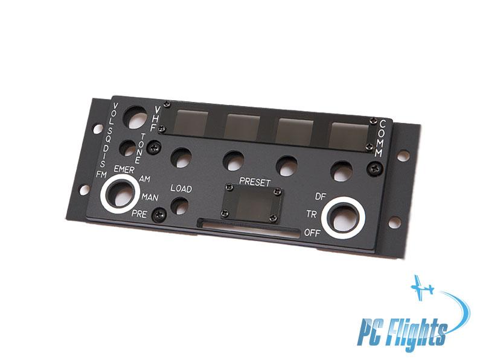

# ARC-186 Radio Panel for DCS

**Last updated: November 7, 2026 at 2:43 PM MST (America/Denver)**
<!-- Refresh this timestamp whenever this README changes; use the actual current America/Denver date and time with the correct MST/MDT abbreviation. -->

  

*Panel reference photo: [PC Flights](https://pcflights.com/a-10c-thunderbolt-warthog-comm-vhf-panel/).*

This project is planned as a physical ARC-186 COMM-VHF radio panel for my DCS A-10C II cockpit, with working controls and a display connected to DCS through DCS-BIOS.

I chose the listed component suppliers because I’m aiming for better-quality parts than I generally expect from generic Amazon listings, even if they cost a little more. Parts from Amazon may work, and I use some myself, but substitutes may have different dimensions or pin spacing and may not fit the PCBs I plan to design for this project. Please compare the exact part specifications and PCB footprint before buying a substitute.

## Project update — November 7, 2026

I am waiting for the **ARC-210 and ARC-164 PCBs to arrive**, so I am now working on the **ARC-186**. I am using this time to plan the controls, displays, and PCB arrangement.

I have requested the ARC-186 panel layout file from PC Flights. **Once I receive it, I will start the PCB design**, using the drawing to line up the controls, displays, and mounting holes and check the available clearances.

## Current development order

My overall build and testing order is the **A-10C II (A-10C2) ARC-210 implementation**, then the **ARC-164**, followed by the **ARC-186**. While I wait for the ARC-210 and ARC-164 PCBs, I am moving ahead with ARC-186 planning and design. Once the ARC-186 is finished, I plan to **take some time off from the radio projects and get back to other things I need to complete**. When I return to radio development, I would like to work on additional aircraft support, starting with the **ARC-210 and C-130J**. I’m focusing on aircraft with a matching physical radio panel.

**This order may change based on user feedback and interest.** These are my current priorities, not fixed release dates.

## Other SIMPIT panels

After that break, I would also like to build other panels for my SIMPIT, including the **SAS and emergency trim panels**. I’ll share those projects as they develop. These are future plans.

## Through-hole components

While I could use surface-mount (SMD) parts to make the boards smaller, I plan to use through-hole components to make the project easier for everyone to build and solder with basic tools, following the same approach as my ARC-210 project.

## Things that need to be completed

**Last updated: November 7, 2026 at 1:44 PM MST (America/Denver)**
<!-- Refresh this section timestamp whenever the work list changes, using the actual America/Denver time and MST/MDT. -->

This is my current work list for the hardware, firmware, testing, and build instructions.

1. **Panel layout and parts:** Confirm dimensions, mounting clearances, controls, display choices, and the complete parts list.
2. **PCB and schematic design:** Design the controller, encoder, switch, and display circuitry, including any display-driver level shifting needed for the chosen controller. Finalize the controller pin assignments and check the electrical design before ordering boards.
3. **Printed parts:** Design and test-fit the required knobs, brackets, and spacers with the selected hardware.
4. **DCS-BIOS mappings and any needed changes:** Check which inputs and display outputs are already available for this radio. Identify missing data, make any necessary export changes, and document them. Check the correct AM/FM radio instance and configuration. The ARC-210 changes do not automatically apply to this panel.
5. **Firmware:** Write the control and display firmware and verify USB communication with DCS-BIOS.
6. **Bench and board testing:** Test the controls, displays, and power requirements together, then assemble and electrically test the manufactured boards.
7. **Testing in DCS:** Check control operation, display updates, startup behavior, reconnection, and extended reliability with the intended aircraft and the other radio panels connected.
8. **Documentation:** Publish assembly instructions, wiring diagrams, final parts and print quantities, PCB ordering files, firmware loading steps, DCS-BIOS setup requirements, and troubleshooting notes. Link to the shared [DCS-BIOS guide](https://github.com/dgdimick/ARC-210-DCS-Display/blob/master/Docs/DCS-BIOS.md) where the instructions already apply.
9. **Assembly pictures:** When my PCBs arrive and I start building, take clear pictures of component placement, soldering, wiring, and mounting, including both sides of each PCB with the silkscreen markings visible. Add the pictures to the assembly instructions so other builders can follow along.

## Assembly tool note

I use **10 mm and 13 mm deep-well sockets** to tighten the **mounting nuts on the rotary switches and encoders**. Use whichever socket fits each nut; the deep well provides clearance over the shaft.

## Controller plan — genuine Arduino Nano

I plan to use a **genuine Arduino Nano, product code A000005**, for the ARC-186, subject to firmware and bench testing. I found an **Amazon-sourced Nano** three-pack for **$15, or $5 per board**. For builders, I recommend a **genuine Arduino Nano**, at about **$17 each**. These are my reported prices; check the current listing before ordering. I have not added product links for these options yet. The plan would use **resistor ladders for the six rotary switches** to reduce the number of input pins.

[DCS-BIOS explicitly supports the classic Nano](https://github.com/DCS-Skunkworks/dcs-bios/blob/main/Scripts/DCS-BIOS/doc/userguide.adoc), using `DCSBIOS_IRQ_SERIAL` for its ATmega328P. **I still need to compile and test the ARC-186 firmware**, check flash and SRAM usage, and test the controls and display updates together before committing the PCB design to it.

The **Teensy 4.1 remains an alternative**, and the [ARC-164](https://github.com/dgdimick/ARC-164-DCS-Display) will retain its own Teensy 4.1. Each radio will have its own USB connection to DCS-BIOS and can be built and operated independently.

### Arduino Nano specifications

These are the specifications from Arduino for **A000005**, which I will use as the reference for the design. See the [Arduino Nano product page](https://store-usa.arduino.cc/products/arduino-nano).

| Specification | Arduino A000005 |
| --- | --- |
| Microcontroller | ATmega328 |
| Architecture | AVR |
| Operating voltage | 5 V |
| Flash memory | 32 KB, of which 2 KB is used by the bootloader |
| SRAM | 2 KB |
| Clock speed | 16 MHz |
| Analog inputs | 8 |
| EEPROM | 1 KB |
| DC current per I/O pin | 20 mA |
| Input voltage (VIN) | 7–12 V |
| Digital I/O pins, as listed by Arduino | 22, including 6 PWM outputs |
| PWM outputs | 6 |
| Listed power consumption | 19 mA |
| PCB dimensions | 18 × 45 mm |
| Weight | 7 g |
| Product code | A000005 |

For the actual pin budget, I will use the [official Nano pinout](https://docs.arduino.cc/resources/pinouts/A000005-full-pinout.pdf): **A6 and A7 are analog-only**, and A0–A5 share analog and digital functions. The board exposes 20 digital-capable pins; analog and digital counts must not be added together as independent pins. I will reserve D0/D1 for serial communication. The 19 mA figure is for the Nano itself, not the complete radio or its LED displays.

### Controller cost comparison

The $5 Amazon-sourced Nano and approximately $17 genuine Arduino Nano options above are separate from this older supplier comparison. The historical supplier comparison below was checked **October 30, 2026**, in **USD per board, before shipping and tax**:

| Controller | Quantity for ARC-186 | Listed price | Supplier |
| --- | ---: | ---: | --- |
| Classic Arduino Nano, ATmega328P — considered, not selected | 1 | $25.70 | [DigiKey](https://www.digikey.com/en/products/detail/arduino/A000005/2638989) |
| Teensy 4.1 without Ethernet | 1 | $29.60 | [SparkFun](https://www.sparkfun.com/development-boards/microcontrollers/teensy/teensy-boards.html) |
| Teensy 4.1, standard, without soldered headers | 1 | $31.50 | [SparkFun](https://www.sparkfun.com/development-boards/microcontrollers/teensy/teensy-boards.html) |
| Teensy 4.1 with soldered headers | 1 | $35.95 | [SparkFun](https://www.sparkfun.com/development-boards/microcontrollers/teensy/teensy-boards.html) |

These are alternative controller options, **not quantities to purchase together**. Unsoldered versions may need separately purchased headers and sockets. Prices can change, and this table is a controller comparison rather than a complete panel build estimate.

In that historical comparison, the Teensy 4.1 without Ethernet was $3.90 more than the genuine Nano. That comparison does not apply to the $5 Amazon Nano option now under consideration. I will confirm the Nano choice by testing the firmware and pin assignments before finalizing the PCB. Ethernet is not required for the planned USB DCS-BIOS connection.

### Display plan

The ARC-186 will use **seven 7-segment LED displays in total**: five for the frequency and two for the preset channel.

### Control mounting and PCB plan

My current control plan is:

| Control | Quantity | Planned type |
| --- | ---: | --- |
| FREQ | 4 | Rotary switches |
| EMER/FM/AM and OFF/TR/DF | 2 | Rotary switches |
| VOL | 1 | Rotary encoder |
| Preset channel wheel | 1 proposed | Horizontal rotary encoder, only if the wheel and mounting prove workable |

That is **six planned rotary switches and one VOL encoder**, plus **one possible channel encoder**. This replaces the earlier five-frequency-encoder plan. The channel-wheel mechanism is still undecided, so I am not treating its encoder as a confirmed part yet.

I plan to use **two separate PCBs for the four FREQ rotary switches**. This is the planned board arrangement for the frequency controls. I will probably also need **3D-printed shaft guides similar to those used on the ARC-210**. Their dimensions and mounting will be worked out during the fit checks. The switches can mount directly to the panel, but I still need to check clearance between the switch bodies, their two PCBs, and the frequency LED displays and display PCB before finalizing the layout.

The seven display digits will have their own **display PCB**. I may also be able to mount the **VOL rotary encoder** on that board, depending on the available space and shaft alignment.

The other **two rotary switches** are the **EMER/FM/AM selector** and **OFF/TR/DF selector**. I can mount both directly to the faceplate; the remaining mounting details still need checking.

I would like to use a **small 3D-printed wheel for the preset channel control**, but **I may not be able to make it work in the available space**. The channel wheel is not a confirmed part of the design; if it proves impractical, I will need to find another way to select preset channels. I am considering a horizontally mounted rotary encoder, but the wheel is very small and **I still need to figure out how to mount and couple it to the encoder**. I will measure the wheel opening and clearance behind the panel before choosing a direct shaft connection, separate axle, or geared arrangement.

The current mechanical plan includes **two FREQ switch PCBs and one separate display PCB**. I may also need **another PCB for the channel control and other components**, depending on the available space and how the channel mechanism works out. Its contents and mounting are still undecided, and the channel wheel itself is not yet confirmed as workable. This is not a final board count for the complete radio: the controller, driver, and any other board requirements still need to be worked out.

These are preliminary plans. I will check the controls, board clearances, and printed parts together before publishing a build-ready design.

### Pin budget and electrical plan

The earlier 19-signal-pin estimate needs revising for the updated rotary-switch and encoder plan. I will confirm the complete control count, use resistor ladders for the Nano option, and recalculate the pin budget during schematic design.

**Pin assignments will be established during schematic design.** The classic Nano uses 5 V logic; its proposed resistor ladders will be designed for its ADC input range and reference. If I use the Teensy 4.1 instead, it uses **3.3 V logic and is not 5 V tolerant**: the 5 V MAX7219 display drivers need suitable logic-level buffering, and the switch resistor ladders must use 3.3 V. See the [PJRC specifications](https://www.pjrc.com/store/teensy41.html).

Before finalizing the PCB, I will verify DCS-BIOS communication, the rotary encoders and switches, display updates, and the display power budget together. The display arrangement and pin budget remain proposed and untested. Firmware will map this single panel to the appropriate AM or FM radio.

## My SIMPIT and test computer

[View my SIMPIT and test computer](https://github.com/dgdimick/ARC-210-DCS-Display/blob/master/Docs/My-SIMPIT-and-Test-Computer.md) for my computer configuration, monitors, and current USB setup. **This describes my own development and flight-simulation setup, not minimum requirements for the radio panels.**

## Parts and supplier links

### USB adapter cable

For the planned Nano controller, I will use **one USB Mini-B-to-USB-C data cable**, with a Mini-B plug for the Nano and a USB-C plug for the computer or hub. The Nano board uses **Mini-USB, not Micro-USB**. I have removed the earlier Micro-B cable link because it does not fit this connector; a matching Mini-B cable product link still needs to be added.

The cable must carry both data and power. A charge-only cable will not carry DCS-BIOS communications or program the controller. Choose a length that suits your installation. If I use the Teensy 4.1 alternative instead, it requires a Micro-B cable.

The complete ARC-186 parts list and build cost are still being developed.

## USB connections and powered hubs

[Read about the USB connection plan and purchased powered hubs](https://github.com/dgdimick/ARC-210-DCS-Display/blob/master/Docs/USB-Connections-and-Powered-Hubs.md) for why I am using USB instead of RS-485.

## DCS-BIOS

[My step-by-step setup guide](https://github.com/dgdimick/ARC-210-DCS-Display/blob/master/Docs/DCS-BIOS.md) covers installation, file changes, and TekConnect—the app I use to manage my connections.

- [Patched A-10C.lua](https://raw.githubusercontent.com/dgdimick/ARC-210-DCS-Display/master/Docs/DCS-BIOS/A-10C.lua) — ARC-210 changes included; for **DCS-BIOS v0.11.8**.
- [DCS-BIOS-only Export.lua](https://raw.githubusercontent.com/dgdimick/ARC-210-DCS-Display/master/Docs/DCS-BIOS/DCS-BIOS-only/Export.lua) — for setups without WWT or SRS.

Follow the guide before replacing files. The ARC-210 patch does not add support for this planned radio.

## Teensy 4.1 background

[Read why I keep using Teensy 4.1s](https://github.com/dgdimick/ARC-210-DCS-Display/blob/master/Docs/Why-I-Keep-Using-Teensy-4.1s.md) for background on my other radio projects and the Teensy alternative. The genuine Arduino Nano is now the planned ARC-186 controller; the Teensy remains a fallback if testing shows it is needed.

## Physical radio panels and possible future support

Any work on additional ARC-186 aircraft support would come **after I finish the ARC-186 and take the planned break**. I have not set a date to return to that work.

I’m focusing future support on aircraft with a **physical ARC-186 control panel** that matches my hardware, so the panel will be useful to builders flying those aircraft. I’ll compare the controls and displays as well as the radio model before deciding which aircraft to support.

| Aircraft | Physical panel | Future-support assessment |
| --- | --- | --- |
| A-10C | Dedicated ARC-186 AM and FM control panels | **Worth investigating alongside the A-10C II build.** Each radio instance needs the correct mapping and configuration. |
| A-10C II | Dedicated ARC-186 FM control panel | **Primary project target.** |
| CH-47F Chinook | ARC-186 backup control head | **Conditional candidate only.** Compare its controls, displays, operating modes, and DCS-BIOS coverage with this panel before deciding whether support is worthwhile. |

References: [A-10C manual](https://www.digitalcombatsimulator.com/upload/iblock/7aa/DCS%20A-10C%20Flight%20Manual%20EN.pdf), [A-10C II manual](https://www.digitalcombatsimulator.com/upload/iblock/715/t05fb1h8itdhcvcf6fyi3h5944fvv4fx/DCS_A-10C_II_Flight_Manual_EN.pdf), and [ED's explanation of the CH-47F backup control head](https://forum.dcs.world/topic/358422-missing-radio/).

**Support for another aircraft would require separate DCS-BIOS mappings, firmware integration, and testing.** Even within the A-10 family, the correct AM/FM radio instance and installed configuration must be identified. The A-10 family remains the practical focus; the CH-47F is an investigation candidate, not a supported aircraft or promised extension.

## Related projects

- [A-10-Sim repository](https://github.com/dgdimick/A-10-Sim) — my collection of A-10C II cockpit panel projects.
- [C-130J ARC-210 support in the main ARC-210 project](https://github.com/dgdimick/ARC-210-DCS-Display/blob/master/Docs/C-130J-Support.md) — planned reuse of my existing ARC-210 hardware with C-130J firmware, DCS-BIOS mappings, and menus. The same panel hardware should work with both the A-10C II and C-130J using the appropriate firmware and mappings; C-130J testing is pending.
- [ARC-210 DCS Display](https://github.com/dgdimick/ARC-210-DCS-Display)
- [ARC-164 DCS Display](https://github.com/dgdimick/ARC-164-DCS-Display)

## Parts offers for the ARC-210

See my [ARC-210 PCB and printed-parts offers](https://github.com/dgdimick/ARC-210-DCS-Display/blob/master/Docs/ARC-210-Parts-Offers.md) for current prices, what’s included, materials, availability, shipping, VAT, and import-charge details. If you request them with my ARC-210 PCB set, I’ll include the complete 3D-printed parts set free of charge. Shipping and handling remain separate.

**These offers are for the ARC-210 only. I don’t currently offer PCB or printed-parts sets for the ARC-164 or ARC-186; their designs and testing are still to come.**

## A central directory for SIMPIT builders

I’d love to see a central GitHub directory linking to other SIMPIT builders’ projects, with files and credit staying with each builder. This is an idea, not a project I’ve committed to building.

[Read more about the directory idea](https://github.com/dgdimick/ARC-210-DCS-Display/blob/master/Docs/Future-Thoughts.md#a-central-directory-for-simpit-builders). If you know of one or would like to discuss it, let me know in [Discussions](https://github.com/dgdimick/ARC-186-DCS-Display/discussions).

## Sharing code and improvements

I plan to share this panel’s main firmware source under the **MIT License**, following the same approach as my ARC-210 project, and I’m happy to provide my available code to anyone who asks. This panel’s firmware is still being developed; the [published ARC-210 source](https://github.com/dgdimick/ARC-210-DCS-Display/tree/master/Firmware/Source/Master_Program) is available now under its [MIT License](https://github.com/dgdimick/ARC-210-DCS-Display/blob/master/Docs/LICENSE-MIT.txt).

If you adapt my code or add improvements, I’d love to work with you and bring useful changes back into the project so other builders—and my other panel projects—can benefit too. Please share your changes through a pull request or get in touch in [Discussions](https://github.com/dgdimick/ARC-186-DCS-Display/discussions). Contributing changes back is welcome, but it isn’t an extra condition of the MIT License. Third-party code keeps its own license.

## Questions and community builds

**Planning a build, already working on one, or just looking around?** Tell me which panel interests you and what you fly in [GitHub Discussions](https://github.com/dgdimick/ARC-186-DCS-Display/discussions). Questions, ideas, and progress photos are welcome—even if you haven’t started yet. If you get stuck, ask away—I’m happy to help where I can.

If you’re local to me in **New Mexico, USA**, I’d be happy to meet up and provide whatever help I can with your SIMPIT. Get in touch through [Discussions](https://github.com/dgdimick/ARC-186-DCS-Display/discussions) so we can talk about your build and arrange a time.

I welcome bug reports from anyone using the project—**even tiny bugs are worth reporting**. If something doesn’t work as expected, please let me know in the [Bugs discussion section](https://github.com/dgdimick/ARC-186-DCS-Display/discussions/categories/bugs). Tell me which firmware version and board revision you’re using, if applicable, what you did, what you expected, and what happened. Reports about the build instructions are welcome too. Your reports help me improve the project for everyone.

## PC Flights affiliation

I am not affiliated with PC Flights. I simply chose to use their panels for my own cockpit projects.

---

[**My Mission Statement — Why I Build and Share These Projects**](https://github.com/dgdimick/A-10-Sim/blob/master/Mission-Statement.md)
