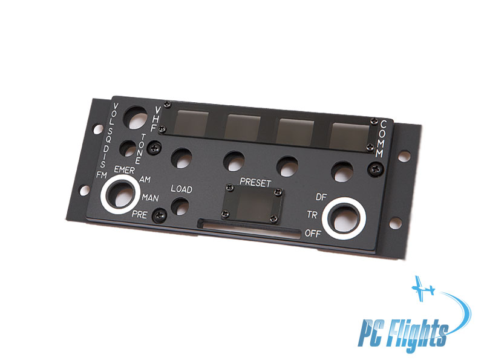

# ARC-186 Radio Panel for DCS

**Last updated: October 30, 2026 at 8:47 PM MDT (America/Denver)**
<!-- Refresh this timestamp whenever this README changes; use the actual current America/Denver date and time with the correct MST/MDT abbreviation. -->

  

*Panel reference photo: [PC Flights](https://pcflights.com/a-10c-thunderbolt-warthog-comm-vhf-panel/).*

This project is planned as a physical ARC-186 COMM-VHF radio panel for my DCS A-10C II cockpit, with working controls and a display connected to DCS through DCS-BIOS.

## Project status

This repository is a placeholder while I work on my other radio projects. There is no firmware or finished hardware design available here yet, and I have not set a release date.

As development progresses, I will share build notes, schematics, firmware, parts lists, and photos here.

## Controller plan — separate Teensy 4.1 controllers

The plan is to use a **dedicated Teensy 4.1 for the ARC-186**, with another **Teensy 4.1 dedicated to the [ARC-164](https://github.com/dgdimick/ARC-164-DCS-Display)**. Each radio will have its own USB connection to DCS-BIOS and can be built and operated independently. This replaces the earlier shared-controller and Arduino Nano proposals.

The **Teensy 4.1 runs at 600 MHz**, compared with **16 MHz for the classic Arduino Uno R3, Mega 2560, and ATmega328P Nano** — **37.5 times the CPU clock frequency**. This provides processing headroom for display updates and controls; it is not a measured 37.5-times improvement in display refresh speed. See the [Teensy specifications](https://www.pjrc.com/store/teensy41.html) and [classic Arduino board comparison](https://github.com/dgdimick/ARC-210-DCS-Display/blob/master/Docs/Why-Teensy.md).

### Controller cost comparison

Reference prices checked **October 30, 2026**, in **USD per board, before shipping and tax**:

| Controller | Quantity for ARC-186 | Listed price | Supplier |
| --- | ---: | ---: | --- |
| Classic Arduino Nano, ATmega328P — considered, not selected | 1 | $25.70 | [DigiKey](https://www.digikey.com/en/products/detail/arduino/A000005/2638989) |
| Teensy 4.1 without Ethernet | 1 | $29.60 | [SparkFun](https://www.sparkfun.com/development-boards/microcontrollers/teensy/teensy-boards.html) |
| Teensy 4.1, standard, without soldered headers | 1 | $31.50 | [SparkFun](https://www.sparkfun.com/development-boards/microcontrollers/teensy/teensy-boards.html) |
| Teensy 4.1 with soldered headers | 1 | $35.95 | [SparkFun](https://www.sparkfun.com/development-boards/microcontrollers/teensy/teensy-boards.html) |

These are alternative controller options, **not quantities to purchase together**. Unsoldered versions may need separately purchased headers and sockets. Prices can change, and this table is a controller comparison rather than a complete panel build estimate.

The Teensy 4.1 without Ethernet costs only **$3.90 more than the genuine Nano** at these prices. That small difference makes the Teensy's additional I/O capacity, processing headroom, and consistency with the ARC-210 and ARC-164 projects worthwhile. Ethernet is not required for the planned USB DCS-BIOS connection.

### Pin budget and electrical plan

The preliminary ARC-186 budget is **19 signal pins**: 10 for five encoders, 3 analog inputs for two rotary-switch resistor ladders and volume, 3 for LOAD and a three-position squelch control, and 3 for a daisy-chained MAX7219 display arrangement. Against the Teensy 4.1's **42 readily accessible I/O pins**, that leaves **23 spare**. Analog inputs are included in those 42 pins; USB communication does not consume header GPIO pins. Encoder push switches and backlighting control are not included in this budget.

The earlier Nano pin assignments have been removed. **Teensy pin assignments will be established during the schematic design**; this is not a Nano pin-for-pin substitution. Teensy 4.1 uses **3.3 V logic and is not 5 V tolerant**. The proposed 5 V MAX7219 display drivers require suitable logic-level buffering, and the volume potentiometer and switch resistor ladders must use 3.3 V. See the [PJRC specifications](https://www.pjrc.com/store/teensy41.html).

Before finalizing the PCB, I will verify DCS-BIOS communication, all five encoders, rotary-switch analog readings, display updates, and the display power budget together. The display arrangement and pin budget remain proposed and untested. Firmware will map this single panel to the appropriate AM or FM radio.

## My SIMPIT and test computer

[View my SIMPIT and test computer](https://github.com/dgdimick/ARC-210-DCS-Display/blob/master/Docs/My-SIMPIT-and-Test-Computer.md) for my computer configuration, monitors, and current USB setup. **This describes my own development and flight-simulation setup, not minimum requirements for the radio panels.**

## USB connections and powered hubs

[Read my DCS-BIOS setup and connection guide](https://github.com/dgdimick/ARC-210-DCS-Display/blob/master/Docs/DCS-BIOS.md) for the DCS-Skunkworks project, TekConnect—the app I use to manage my connections—and the ARC-210 export changes.

[Read about the USB connection plan and purchased powered hubs](https://github.com/dgdimick/ARC-210-DCS-Display/blob/master/Docs/USB-Connections-and-Powered-Hubs.md) for why I am using USB instead of RS-485, GPIO availability, sharing a Teensy across smaller panels, and expansion using my existing cockpit USB setup.

## Why I keep using Teensy 4.1s

[Read why I keep using Teensy 4.1s](https://github.com/dgdimick/ARC-210-DCS-Display/blob/master/Docs/Why-I-Keep-Using-Teensy-4.1s.md) for the consistency, processing speed, available pins, and cost comparison behind the controller choice.

## Physical radio panels and possible future support

Future support will focus on aircraft with a **physical ARC-186 control panel** that this hardware can reasonably represent. Merely installing the same transceiver, with operation through integrated avionics, is not sufficient.

| Aircraft | Physical panel | Future-support assessment |
| --- | --- | --- |
| A-10C | Dedicated ARC-186 AM and FM control panels | **Worth investigating alongside the A-10C II build.** Each radio instance needs the correct mapping and configuration. |
| A-10C II | Dedicated ARC-186 FM control panel | **Primary project target.** |
| CH-47F Chinook | ARC-186 backup control head | **Conditional candidate only.** Compare its controls, displays, operating modes, and DCS-BIOS coverage with this panel before deciding whether support is worthwhile. |

References: [A-10C manual](https://www.digitalcombatsimulator.com/upload/iblock/7aa/DCS%20A-10C%20Flight%20Manual%20EN.pdf), [A-10C II manual](https://www.digitalcombatsimulator.com/upload/iblock/715/t05fb1h8itdhcvcf6fyi3h5944fvv4fx/DCS_A-10C_II_Flight_Manual_EN.pdf), and [ED's explanation of the CH-47F backup control head](https://forum.dcs.world/topic/358422-missing-radio/).

**Support for another aircraft would require separate DCS-BIOS mappings, firmware integration, and testing.** Even within the A-10 family, the correct AM/FM radio instance and installed configuration must be identified. The A-10 family remains the practical focus; the CH-47F is an investigation candidate, not a supported aircraft or promised extension.

## Related projects

- [ARC-210 DCS Display](https://github.com/dgdimick/ARC-210-DCS-Display)
- [ARC-164 DCS Display](https://github.com/dgdimick/ARC-164-DCS-Display)

## Questions and community builds

Visit [GitHub Discussions](https://github.com/dgdimick/ARC-186-DCS-Display/discussions) to ask questions, share ideas, and post photos of your build. Whether you’re planning your panel or already working on it, you’re welcome to join in!

## PC Flights affiliation

I am not affiliated with PC Flights. I simply chose to use their panels for my own cockpit projects.
